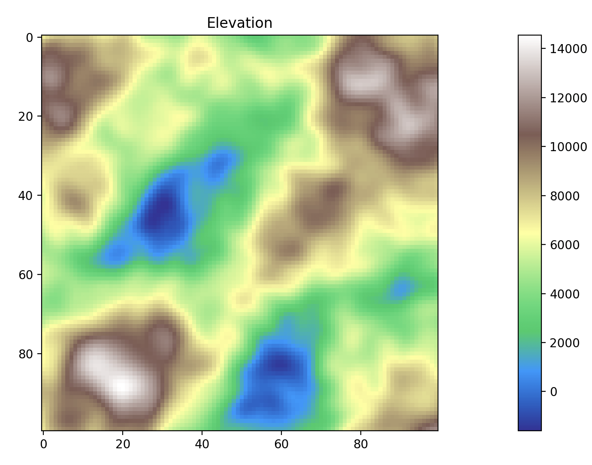

## Terrain Generation, Pt. I: Elevation

In [Chunking, Pt. I](../008_chunking_i/), we figured out a way to generate a world map as a planar graph, using Poisson disk sampling and Bridson's algorithm to generate vertices, Prim's algorithm to create a minimum spanning tree connecting them, and injecting vertices semi-randomly to add cycles and improve navigability and nonlinearity.

In [Chunking, Pt. II](../009_chunking_ii/), we devised a system, "Juice," that used some proxies for player engagement (proximity and recency) to determine how to allocate computing resources to regions; not just loading and unloading them as chunks, but making agents more active, battles more violent, and so forth.

In this article, the first in a series about terrain generation, we will discuss how each region's environmental characteristics are determined through layered noise sampling.

## The Layered Approach

Our world generation employs multiple independent noise layers across the same coordinate space, each representing a different environmental dimension:

- **Elevation**: Mountain peaks to ocean depths
- **Humidity**: Arid deserts to tropical rainforests  
- **Temperature**: Polar ice to scorching badlands
- **Additional layers**: Rainfall patterns, wind exposure, magical energy, etc.

Each layer uses multi-octave Simplex noise for natural variation. We generate broad patterns first, then add finer detail at half the amplitude but double the frequency, repeating this process to create realistic fractal complexity.

## Integration with Graph Chunks

The key insight is that our graph-based world structure and continuous noise layers serve different purposes:

- **Graph structure** defines *connectivity* and *navigation* between regions
- **Noise layers** define *environmental characteristics* of each region

When generating a chunk at coordinates (x, y), we sample all noise layers at that point to determine the chunk's biome and properties. A chunk at high elevation + low humidity might become an "Alpine Desert," while high elevation + high humidity creates a "Cloud Forest."

This approach allows for rich environmental diversity while maintaining the flexible topology of our graph-based world. Graph edges can represent mountain passes, river crossings, or magical portals that connect disparate biomes in narratively interesting ways.

The noise layers provide consistent environmental properties—a chunk's elevation remains stable whether accessed from the north or south—while the graph structure allows for non-Euclidean connections that serve gameplay and narrative needs.
