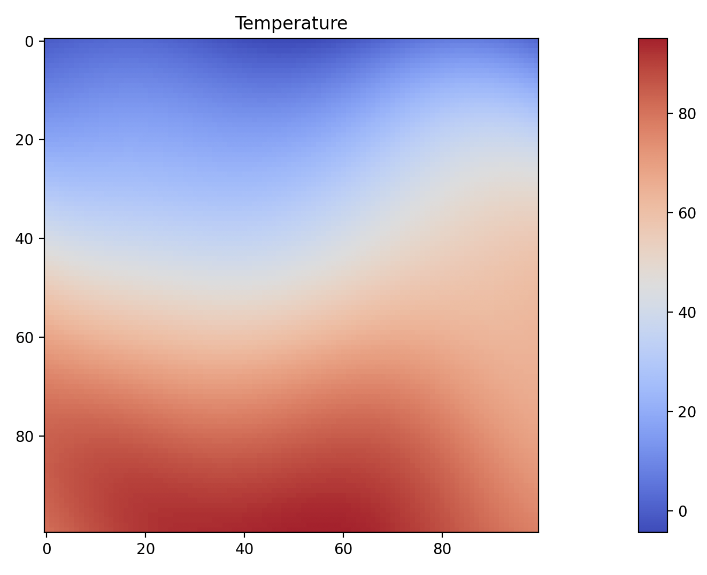
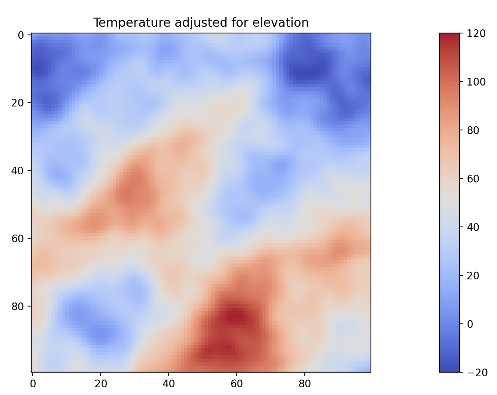

## Terrain Generation, Pt. II: Temperature

In [Terrain Generation, Pt. I](../010_terrain_i/), we established our layered noise approach, starting with elevation as a foundational environmental layer. Now we build upon that foundation by adding temperature—our second environmental dimension that will help determine biome characteristics for each chunk.

## Base Temperature Generation

Base temperature combines two components:

1. **Simplex noise** for regional variation and weather patterns
2. **Latitudinal gradient** where regions closer to poles are colder and equatorial regions are warmer

This creates natural climate zones while allowing for local variations that make the world feel more dynamic and less predictable.



I think that looks pretty nice. A little bit of random variation, in a reasonable range of temperatures (~-10º-90ºF) for a spring day across several biomes, from a harsh desert (Death Valley is about 80º in March) to an icy waste; many places on Earth get considerably colder than this, but I'm not particularly interested in simulating them.

## Elevation-Adjusted Temperature

We then modify the base temperature using elevation and a lapse rate calculation:

```
adjusted_temperature = base_temperature - (elevation * lapse_rate_multiplier)
```

Real-world lapse rates average about 3.5°F per 1000 feet of elevation. For gameplay purposes, we amplify this to roughly 10-15°F per 1000 feet, creating dramatic transitions that allow snow-capped peaks to exist near desert valleys. This compression of climate zones serves the narrative goal of diverse, interesting biomes within reasonable travel distances.



## Integration with World Generation

When generating a chunk at coordinates (x, y), we sample both the base temperature noise and elevation at that point, then apply the lapse rate calculation to determine the chunk's temperature characteristics. This ensures consistent environmental properties regardless of how the player approaches the chunk through our graph-based world structure.

## Seasonal and Daily Variation

While the base temperature map remains constant, we can layer additional variation for different times of year and day. Seasonal swings might range from ±20°F in temperate regions to ±5°F in more stable climates. These temporal changes affect:

- **NPC behavior**: Creatures seeking shelter in winter, increased activity in spring
- **Resource availability**: Frozen rivers blocking trade routes, seasonal fruit harvests
- **Travel conditions**: Snow making mountain passes treacherous, desert heat requiring water management

## Building Toward Biome Classification

Temperature, combined with elevation, begins to suggest major climate categories. A high-elevation, low-temperature chunk hints at alpine conditions, while low-elevation, high-temperature suggests desert or tropical environments. As we add humidity and other environmental layers, these temperature foundations will help determine the rich biome diversity that makes each region distinctive and memorable.
